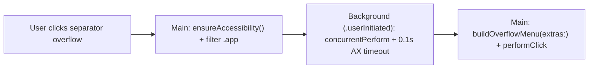

# Architecture & Technical Design

## 1. Overview & Invariants
This change cleans up 7 verified dead-code items and applies 5 targeted performance optimizations without changing user-facing behavior:
- Dead files `NSBarButtonItem+Extension.swift` and `NSView+Extension.swift` are deleted from disk and `Hidden Bar.xcodeproj/project.pbxproj`.
- `NotchOverflowController.buildOverflowMenu(extras:boundary:)` remains synchronous when `extras` is injected so `HiddenTests` stays deterministic.
- `MenuBarClock.swift` stays synchronous to avoid `.leftMouseDown`/`.leftMouseUp` races.

## 2. Domain Models, State & Interface Contracts
- `MenuBarExtraInfo`: remove `pid: pid_t` property; update `NotchOverflowMenuBuilderTests` / `MenuBarExtraClassifierTests` fixtures accordingly.
- `NotchOverflowController`:
  - `fetchMenuBarExtras(completion: @escaping ([MenuBarExtraInfo]) -> Void)` snapshots `(pid, localizedName, icon)` for `.app` bundles (`$0.processIdentifier != ownPID && $0.bundleURL?.pathExtension == "app"`) on main, runs `DispatchQueue.concurrentPerform` with `AXUIElementSetMessagingTimeout(axApp, 0.1)` on `.userInitiated`, skips zero-sized items before building `MenuBarExtraInfo`, and calls `completion` on `DispatchQueue.main`.
  - `showOverflowMenuFromSeparator(near item: NSStatusItem)` calls `fetchMenuBarExtras`, builds `NSMenu` on main, attaches `item.menu`, and triggers `item.button?.performClick(nil)`.
- `StatusBarController`:
  - Cache `cachedMenuBarFrames: [CGRect]` computed from `NSScreen.screens` (lazily populated, cleared on `handleScreenParametersChanged`).
- `Date+Extension.swift`: static `dateFormatter` and `timeFormatter` (`DateFormatter`).
- `Assets.swift`: static cached `expandImage` / `collapseImage`.
- `LegacyLengthEngine.swift`: `NSScreen.screens.max(by: { $0.frame.width < $1.frame.width })?.frame.width ?? 1728`.

## 3. Architecture Diagram & Data Flow

## 4. Boundary Rules & Budgets
- **Pure Core vs. I/O Shell**: `MenuBarExtraClassifier.classify(_:boundary:)` and `buildOverflowMenu(extras:boundary:)` remain pure/synchronous over `[MenuBarExtraInfo]`; AX IPC and `NSWorkspace` live in `fetchMenuBarExtras`.
- **Concurrency, Latency & Resource Budgets**: Zero `AXUIElementCopyAttributeValue` calls on main thread in `showOverflowMenuFromSeparator`; per-app AX IPC capped at `0.1s`.

## 5. Testing Strategy
1. **Unit Tests**: Run `make test` (`HiddenBarTests` + `HiddenTests`), updating any `MenuBarExtraInfo` test fixtures for removed `pid`.
2. **Build Verification**: Run `make build` (`Release-Direct`) after removing files from `project.pbxproj`.

## Review Gate
- [x] **Gate 2 Approval**: Architecture & design reviewed and approved by human before task breakdown.
