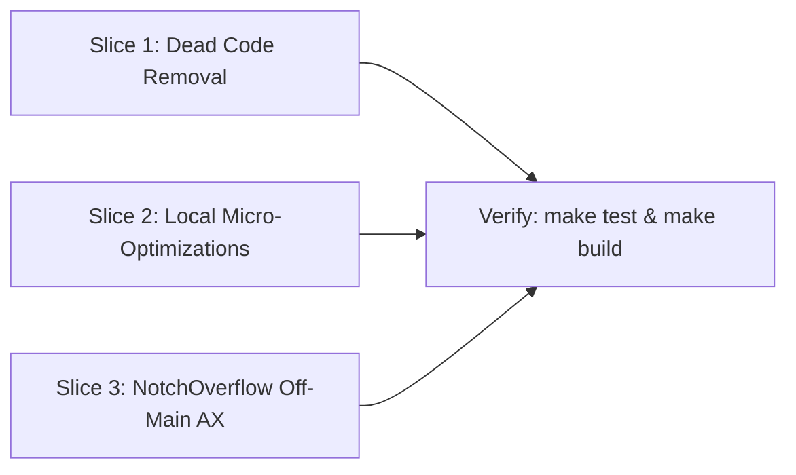

# Tasks

## 1. Dependency DAG

## 2. Streams & Worktrees
| Stream | Worktree Path | Branch | Prerequisite |
| :--- | :--- | :--- | :--- |
| Main | `.` | `develop` | None |

## 3. Slice 1: Dead Code Removal
- [x] 3.1 Delete `hidden/Views/NSBarButtonItem+Extension.swift` and `hidden/Views/NSView+Extension.swift` and remove their entries from `Hidden Bar.xcodeproj/project.pbxproj` (verify: `make build`)
- [x] 3.2 Remove `GlobalKeybindPreferences.save()`, `Constant.appName`, unused `PreferencesViewController` `@IBOutlet`s (`checkBoxKeepLastState`, `imageViewTop`, `checkBoxKeepInDock`), and `HyperlinkTextField.awakeFromNib()` (verify: `make build`)
- [x] 3.3 Remove write-only `MenuBarExtraInfo.pid` from `NotchOverflowController.swift` and update `HiddenTests` fixtures (verify: `make test`)

## 4. Slice 2: Local Micro-Optimizations
- [x] 4.1 Cache `DateFormatter` in `hidden/Extensions/Date+Extension.swift` as `static let` (verify: `make test`)
- [x] 4.2 Cache `expandImage` and `collapseImage` in `hidden/Common/Assets.swift` (verify: `make build`)
- [x] 4.3 Replace `.map { $0.frame.width }.max()` with `.max(by:)` in `hidden/Features/StatusBar/Engine/LegacyLengthEngine.swift` (verify: `make test`)
- [x] 4.4 Cache menu-bar screen rects in `hidden/Features/StatusBar/StatusBarController.swift` and invalidate on `didChangeScreenParametersNotification` (verify: `make build`)

## 5. Slice 3: NotchOverflow Off-Main AX
- [x] 5.1 Refactor `NotchOverflowController.getAllMenuBarExtras()` to filter `.app` bundles, set `0.1s` `AXUIElementSetMessagingTimeout`, scan concurrently off-main via `DispatchQueue.concurrentPerform`, skip zero-sized items before fetching `app.icon`, and show the menu on `DispatchQueue.main` in `showOverflowMenuFromSeparator(near:)` (verify: `make test && make build`)

## 6. Integration & Verification
- [x] 6.1 Run full test suite (`make test`) and release build (`make build`)

## Review Gate
- [x] **Gate 3 Approval**: Tasks breakdown approved by human before writing test code.
