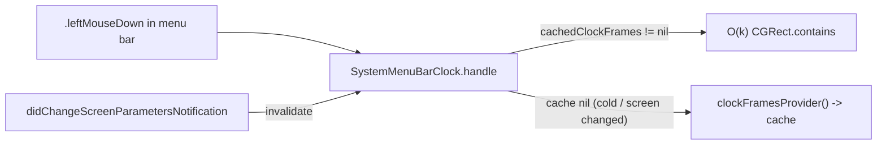

# Architecture & Technical Design

## 1. Overview & Invariants
This change performs a targeted second-pass cleanup and performance hardening across `PreferencesViewController`, `NotchOverflowController`, `StatusBarController`, `MenuBarClock`, and `Assets.xcassets`.

**Key Invariants:**
- **Main-thread UI/AppKit safety:** `NSRunningApplication.icon` and `NSImage` resizing happen only on the main thread.
- **Zero stale clock geometry:** `SystemMenuBarClock` clears cached clock frames on `NSApplication.didChangeScreenParametersNotification` and on `stop()`.
- **Clean teardown:** `StatusBarController.deinit` invalidates all timers and removes all notification center observers (`default` and `NSWorkspace.shared.notificationCenter`).

## 2. Domain Models, State & Interface Contracts
- **`NotchGeometry` (`NotchOverflowController.swift`):** `computeBoundary(menuBarItems:visibleMaxX:)` drops unused `screenFrame: CGRect`.
- **`NotchOverflowController`:**
  - `MenuBarExtraInfo` stores `app: NSRunningApplication` (or `pid` / `bundleIdentifier` + icon resolved on main thread) instead of reading `entry.app.icon` inside `concurrentPerform`.
  - `buildOverflowMenu(extras: [MenuBarExtraInfo], boundary: CGFloat)` takes non-optional `extras`; delete `getAllMenuBarExtras()`.
  - Add an in-memory `resizedIconCache: [String: NSImage]` keyed by `"\(bundleID):\(tinted)"` (cleared on `invalidate()` / bounded if needed).
- **`SystemMenuBarClock` (`MenuBarClock.swift`):**
  - Store `private var cachedClockFrames: [CGRect]?` and a `didChangeScreenParametersNotification` observer token.
  - Extract `private func currentClockFrames() -> [CGRect]` (reads `cachedClockFrames` if non-nil, else resolves via `clockFramesProvider()` and caches). Inject `clockFramesProvider` in `init` for deterministic unit testing.
- **`StatusBarController`:** `deinit` adds `timer?.invalidate()` and `NSWorkspace.shared.notificationCenter.removeObserver(self)`.

## 3. Architecture Diagram & Data Flow

## 4. Boundary Rules & Budgets
- **Pure Core vs. I/O Shell:** `NotchGeometry.computeBoundary` remains pure geometry; `SystemMenuBarClock` abstracts AX lookup behind an injectable `clockFramesProvider` closure for unit testing without live `MenuBarAgent` AX.
- **Concurrency, Latency & Resource Budgets:**
  - `NFR-PERF-1`: Warm `SystemMenuBarClock` hit-test uses 0 AX IPC calls.

## 5. Testing Strategy
1. **BDD / Unit Tests:**
   - Update `HiddenTests/NotchGeometryTests.swift` for `computeBoundary` signature.
   - Add `SystemMenuBarClock` cache hit / screen-parameter invalidation tests in `HiddenBarTests/MenuBarEngineTests.swift` (injecting mock `clockFramesProvider`).
2. **Build & Regression:** `make test` (`HiddenBarTests` + `HiddenTests`) and `make build` (`Release-Direct`) must pass.

## Review Gate
- [x] **Gate 2 Approval**: Architecture & design reviewed and approved by human before task breakdown.
