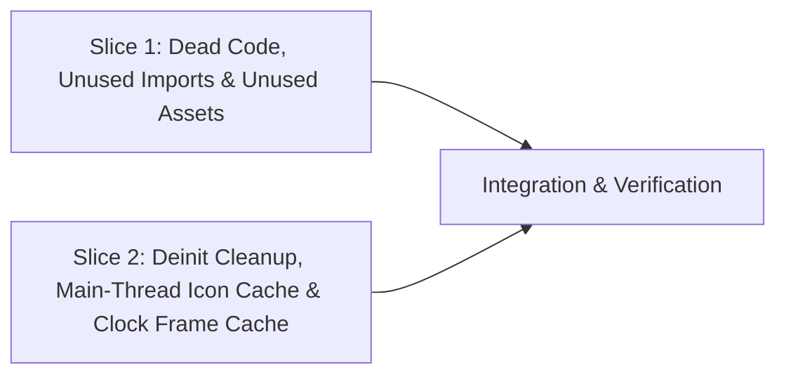

# Tasks

## 1. Dependency DAG

## 2. Streams & Worktrees
| Stream | Worktree Path | Branch | Prerequisite |
| :--- | :--- | :--- | :--- |
| deadcode-assets | `.worktrees/cleanup-pass2-deadcode` | `cleanup/pass2-deadcode` | Gate 3 Approval |
| perf-lifecycle | `.worktrees/cleanup-pass2-perf` | `cleanup/pass2-perf` | Gate 3 Approval |

## 3. Slice 1: Dead Code, Unused Imports & Unused Assets

- [x] 3.0 Remove `@IBOutlet weak var textFieldTitle` from `hidden/Features/Preferences/PreferencesViewController.swift` and disconnect `v43-3R-PwU` in `hidden/Base.lproj/Main.storyboard` (verified: disconnected & removed)
- [x] 3.1 Remove unused `import Carbon` (`PreferencesViewController.swift`) and redundant `import Foundation` (`HyperlinkTextField.swift`, `Util.swift`, `CaptureActivityMonitor.swift`) (verified: compiles cleanly)
- [x] 3.2 Remove `getAllMenuBarExtras()` and make `extras` non-optional in `NotchOverflowController.buildOverflowMenu(extras:boundary:)`; remove `screenFrame:` from `NotchGeometry.computeBoundary` and update callers in `NotchOverflowController.swift` and `HiddenTests/NotchGeometryTests.swift` (verified: `make test` passes)
- [x] 3.3 Delete unused `.imageset` folders in `hidden/Assets.xcassets/` (`banner_alway_hide.imageset`, `banner.imageset`, `ic_dot.imageset`, `ico_fb.imageset`) (verified: `make build` passes)

## 4. Slice 2: Deinit Cleanup, Main-Thread Icon Cache & Clock Frame Cache

- [x] 4.0 Add `timer?.invalidate()` and `NSWorkspace.shared.notificationCenter.removeObserver(self)` to `StatusBarController.deinit` in `hidden/Features/StatusBar/StatusBarController.swift` (verified: `make test` passes)
- [x] 4.1 Move `NSRunningApplication.icon` reading to main-thread `makeMenuItem` and cache resized menu icons in `NotchOverflowController.swift` (verified: `make test` passes)
- [x] 4.2 Add `clockFramesProvider` injection + `cachedClockFrames` caching (invalidated on `didChangeScreenParametersNotification` and `stop()`) to `SystemMenuBarClock` in `hidden/Features/StatusBar/Engine/Native/MenuBarClock.swift` + unit test (verified: `make test` passes)

## 5. Integration & Verification
- [x] 5.1 Run full `make test` and `make build` (`Release-Direct`) (verified: both exited 0)
- [x] 5.2 Commit cleanly and `openspec archive cleanup-deadcode-perf-pass2`

## Review Gate
- [x] **Gate 3 Approval**: Tasks breakdown approved by human before writing test code.
