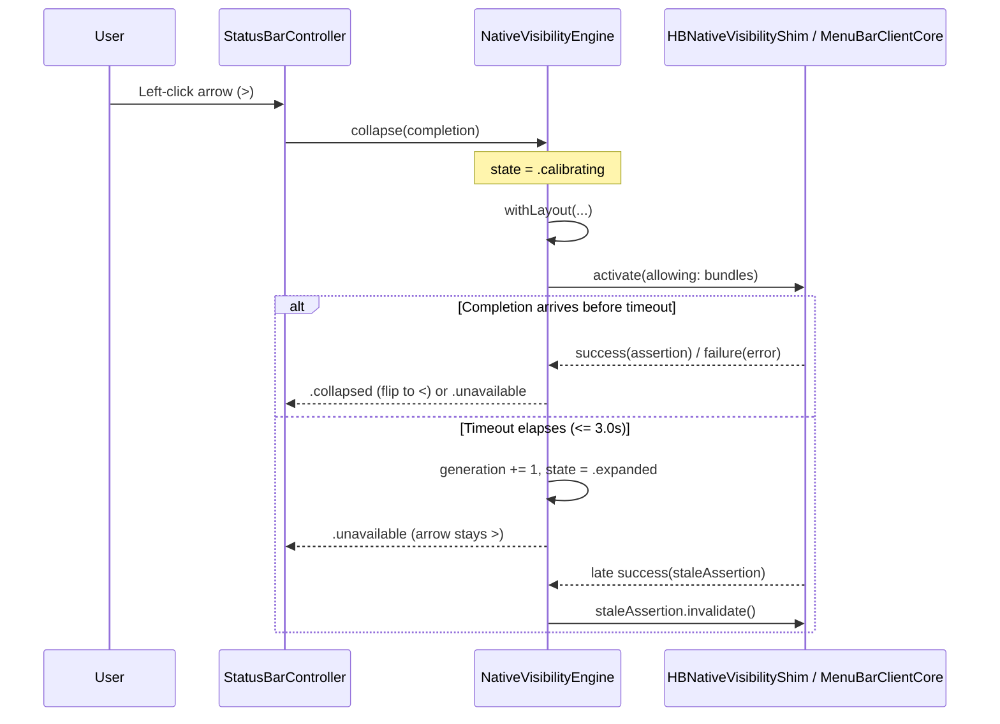

# Architecture & Technical Design

## 1. Overview & Invariants
This change fixes `NativeVisibilityEngine` and `HBNativeVisibilityShim.m` for macOS 27.2.1 (`26B131`) so arrow clicks never wedge permanently in `.calibrating` and `MenuBarClientCore` assertion activation either succeeds or fails open with clear diagnostics.

**Key Invariants:**
- **No permanent `.calibrating` state:** Every entry into `.calibrating` MUST exit to `.collapsed`, `.expanded`, or `.unavailable` within the bounded activation timeout (`NFR-NATIVE-1`) or immediately upon `expand()` / `invalidateLayout()`.
- **Stale-generation safety:** Any callback arriving for `generation != self.generation` MUST invalidate any returned `NativeVisibilityAssertion` and MUST NOT mutate `state` or `self.assertion`.
- **Fail-open default:** Activation failure, timeout, or unavailability leaves `assertion == nil` and `state != .collapsed` so user menu-bar icons are never hidden unintentionally.

## 2. Domain Models, State & Interface Contracts
- **`NativeVisibilityEngine` (`hidden/Features/StatusBar/Engine/NativeVisibilityEngine.swift`):**
  - Inject `activationTimeout: TimeInterval = 2.0` (default 2.0s; configurable in `init` for fast deterministic unit tests, e.g., `0.05`s).
  - In `activate(allowing:completion:)`:
    - Bump `generation += 1` and capture `let generation = self.generation`.
    - Wrap completion in a main-queue one-shot `settled` flag so either the `visibility.activate(...)` callback OR a scheduled `DispatchQueue.main.asyncAfter(deadline: .now() + activationTimeout)` wins — never both.
    - On timeout (while `generation == self.generation`): log `"NativeVisibility: activation timed out after \(activationTimeout)s"`, bump `self.generation += 1` (so a late success is treated as stale and invalidated), release any held assertion, and invoke `completion(false)`.
  - In `invalidateLayout()`: if `state == .calibrating`, bump `generation += 1` and reset `state = .expanded` even if `assertion == nil`.
  - In `expand()`: already sets `state = .expanded` and bumps `generation += 1` via `applyExpandedPresentation()` -> `releaseAssertion()`.
  - Diagnostics: log failure reason on each failed `collapse(completion:)` instead of suppressing all subsequent clicks via `logUnavailableOnce`.
- **`HBNativeVisibilityShim.m` (`hidden/Features/StatusBar/Engine/Native/HBNativeVisibilityShim.m`):**
  - After inspecting `MenuBarAgent` / `MenuBarClientCore` on `26B131` (and testing `SIGNING=""` vs `CODE_SIGNING_ALLOWED=NO`), update selector/configuration/retention or `Makefile` / `Hidden-Direct.entitlements` if `26B131` changed the XPC/signing/selector contract.

## 3. Architecture Diagram & Data Flow

## 4. Boundary Rules & Budgets
- **Pure Core vs. I/O Shell:** `MenuBarLayoutResolver` remains pure geometry logic; `NativeVisibilityEngine` coordinates state transitions and delegates all `MenuBarClientCore` FFI/XPC calls to `NativeVisibilityProviding` (`HBNativeVisibilityShim.m`), keeping `NativeVisibilityEngine` 100% unit-testable via mock `NativeVisibilityProviding`.
- **Concurrency, Latency & Resource Budgets:**
  - All `NativeVisibilityEngine` state mutations and `settled` timeout guards execute on the main queue.
  - Activation timeout budget (`NFR-NATIVE-1`): default `2.0`s (`<= 3.0`s).

## 5. Testing Strategy
1. **BDD Scenarios:** Map `REQ-NATIVE-1` through `REQ-NATIVE-4` and `NFR-NATIVE-1` directly to test cases in `HiddenBarTests/MenuBarEngineTests.swift`.
2. **Unit Tests (>= 95% coverage on new/changed `NativeVisibilityEngine` paths):**
   - Hanging `NativeVisibilityProviding` triggers timeout within budget, resets `state == .expanded`, returns `.unavailable`, and allows a subsequent `collapse` to succeed.
   - Late completion after timeout invalidates the stale `NativeVisibilityAssertion` and does not flip `state` to `.collapsed`.
   - `expand()` or `invalidateLayout()` called during `.calibrating` resets `state` to `.expanded` and invalidates any late assertion.
3. **Manual Verification on macOS 27.2.1 (`26B131`):** Build and install `/Applications/Hidden Bar.app`, verify `>` folds and flips to `<`, `<` expands, and `Option`-click toggles Always Hidden.

## Review Gate
- [x] **Gate 2 Approval**: Architecture & design reviewed and approved by human before task breakdown.
