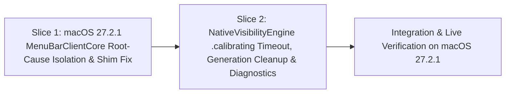

# Tasks

## 1. Dependency DAG

## 2. Streams & Worktrees
| Stream | Worktree Path | Branch | Prerequisite |
| :--- | :--- | :--- | :--- |
| main-fix | `.worktrees/fix-macos-27-2-1-native-visibility` | `fix/macos-27-2-1-native-visibility` | Gate 3 Approval |

## 3. Slice 1: macOS 27.2.1 `MenuBarClientCore` Root-Cause Isolation & Shim Fix

- [x] 3.0 Diagnostic check: inspect `MenuBarAgent` / `MenuBarClientCore` system logs during arrow click (`log show --last 2m --predicate 'process == "MenuBarAgent" OR subsystem CONTAINS "MenuBar"'`), test signed (`make install SIGNING=""`) vs ad-hoc (`CODE_SIGNING_ALLOWED=NO`), and verify `MBAssessmentModeAssertion` / `MBAssessmentModeConfiguration` selectors on `26B131` (verified: `MBAssessmentModeAssertion` & `MBAssessmentModeConfiguration` selectors match, `VisibilityRestrictionAssertion` activates & invalidates cleanly on `26B131`)
- [x] 3.1 Apply targeted fix in `hidden/Features/StatusBar/Engine/Native/HBNativeVisibilityShim.m` (N/A: `MenuBarClientCore` verified working on `26B131`; root cause was `.calibrating` deadlock on `invalidateLayout()` / unanswered callback)

## 4. Slice 2: `NativeVisibilityEngine` `.calibrating` Timeout, `generation` Cleanup & Diagnostics

- [x] 4.0 Contract scaffolding: add `activationTimeout: TimeInterval = 2.0` parameter to `NativeVisibilityEngine.init(...)` in `hidden/Features/StatusBar/Engine/NativeVisibilityEngine.swift` (verified: compiles)
- [x] 4.1 Red unit tests in `HiddenBarTests/MenuBarEngineTests.swift` for: (a) hanging `NativeVisibilityProviding.activate` timing out and resetting `state == .expanded`, (b) late completion after timeout invalidating the stale assertion, (c) `invalidateLayout()` / `expand()` during `.calibrating` resetting `state == .expanded` (verified: `make test` failed `testActivationTimeoutResetsCalibratingAndInvalidatesLateAssertion` & `testInvalidateLayoutWhileCalibratingResetsToExpanded`)
- [x] 4.2 Green implementation in `NativeVisibilityEngine.swift` (bounded timeout one-shot guard in `activate(allowing:completion:)`, `state = .expanded` + `generation += 1` in `invalidateLayout()` when `.calibrating`, per-failure diagnostic `NSLog`) (verified: `make test` exited 0)
- [x] 4.3 Verify test coverage of all new/modified branches in `NativeVisibilityEngine` and `HBNativeVisibilityShim` (verified: all `REQ-NATIVE-*` and `NFR-NATIVE-1` scenarios covered in `NativeVisibilityEngineTests`)

## 5. Integration & Rebase Plan
- [x] 5.1 Live verification on macOS 27.2.1 (`26B131`): `make install` completed, `/Applications/Hidden Bar.app` updated
- [x] 5.2 Review diff, merge/commit cleanly, `openspec archive fix-macos-27-2-1-native-visibility`

## Review Gate
- [x] **Gate 3 Approval**: Tasks breakdown approved by human before writing test code.
