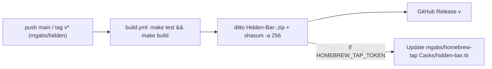

# Architecture & Technical Design

## 1. Overview & Invariants
Coordinates three aligned updates across `mgabs/hidden` and `mgabs/homebrew-tap`:
1. Bundle identifier rename (`com.dwarvesv.minimalbar` -> `com.mgabs.hiddenbar`).
2. GitHub Actions release packaging & automated tap bump (`.github/workflows/build.yml`).
3. Homebrew cask definition (`homebrew-tap/Casks/hidden-bar.rb`).

**Key Invariants:**
- **Zip & asset naming:** Release asset filename MUST match `Hidden-Bar-<version>.zip` across `build.yml` and `Casks/hidden-bar.rb` (`url "https://github.com/mgabs/hidden/releases/download/v#{version}/Hidden-Bar-#{version}.zip"`).
- **Bundle ID parity:** `PRODUCT_BUNDLE_IDENTIFIER`, `uninstall quit:`, and `zap trash:` all reference `com.mgabs.hiddenbar`.
- **Clean break:** Zero runtime migration code from `com.dwarvesv.minimalbar`.

## 2. Domain Models, State & Interface Contracts
- **`Hidden Bar.xcodeproj/project.pbxproj`:** Update 4 app configs -> `com.mgabs.hiddenbar`, 4 `HiddenTests` configs -> `com.mgabs.hiddenbar.HiddenTests`.
- **`.github/workflows/build.yml`:**
  - Triggers: `push` (`branches: [main]`, `tags: ['v*']`) and `workflow_dispatch`.
  - `permissions: contents: write`.
  - Extract version from tag (`${GITHUB_REF_NAME#v}`) or `Info.plist` (`CFBundleShortVersionString`).
  - Package `build/Hidden-Bar-${VERSION}.zip` via `ditto -c -k --sequesterRsrc --keepParent`, compute `SHA256` via `shasum -a 256`.
  - Publish GitHub Release (`softprops/action-gh-release@v2` when tagged or on `main` release).
  - If `secrets.HOMEBREW_TAP_TOKEN != ''`: checkout `mgabs/homebrew-tap`, update `version` and `sha256` in `Casks/hidden-bar.rb`, commit and push if changed.
- **`/Users/mmetawea/Workbench/homebrew-tap/Casks/hidden-bar.rb`:**
  - `cask "hidden-bar"`, `depends_on macos: ">= :ventura"`, `app "Hidden Bar.app"`, `postflight_steps` (`xattr -dr com.apple.quarantine {{appdir}}/Hidden Bar.app`), `uninstall quit: "com.mgabs.hiddenbar"`, `zap trash` for `com.mgabs.hiddenbar`.

## 3. Architecture Diagram & Data Flow

## 4. Boundary Rules & Budgets
- **Pure Core vs. I/O Shell:** No runtime Swift logic changes beyond test fixtures and a `defaults write` comment in `StatusBarController.swift`.
- **Idempotency (`NFR-REL-1`):** Tap bump step checks `git diff --quiet` before committing/pushing, and skips cleanly when `HOMEBREW_TAP_TOKEN` is unset.

## 5. Testing Strategy
1. **Xcode (`mgabs/hidden`):** `make test` + `make build`, plus verify `defaults read .../Info.plist CFBundleIdentifier` equals `com.mgabs.hiddenbar`.
2. **Homebrew Tap (`mgabs/homebrew-tap`):** `ruby test/test_tap.rb`, `brew audit --cask hidden-bar` (or tap audit), `brew style Casks/hidden-bar.rb`.

## Review Gate
- [x] **Gate 2 Approval**: Architecture & design reviewed and approved by human before task breakdown.
