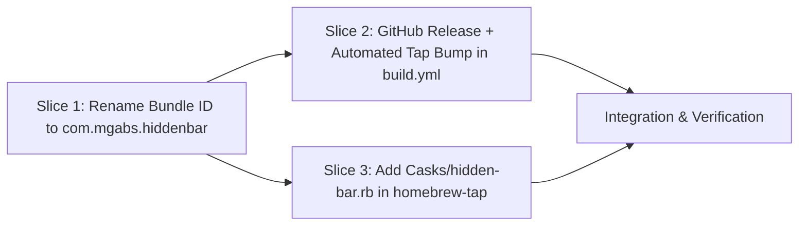

# Tasks

## 1. Dependency DAG

## 2. Streams & Worktrees
| Stream | Worktree Path | Branch | Prerequisite |
| :--- | :--- | :--- | :--- |
| hidden-rebrand | `.worktrees/rebrand-bundle-ci` | `feat/rebrand-com-mgabs-hiddenbar` | Gate 3 Approval |
| homebrew-cask | `/Users/mmetawea/Workbench/homebrew-tap` | `main` | Gate 3 Approval |

## 3. Slice 1: Rename Bundle ID to `com.mgabs.hiddenbar`

- [x] 3.0 Update `PRODUCT_BUNDLE_IDENTIFIER` in `Hidden Bar.xcodeproj/project.pbxproj` (`com.mgabs.hiddenbar` and `com.mgabs.hiddenbar.HiddenTests`) (verified: `Info.plist` in built `.app` reports `com.mgabs.hiddenbar`)
- [x] 3.1 Update test fixtures (`HiddenBarTests/MenuBarEngineTests.swift`, `HiddenTests/MenuBarLayoutResolverTests.swift`), comment (`StatusBarController.swift`), and active docs (`README.md`, `hidden/README.md`, `docs/MANUAL.md`, `docs/RUNBOOK.md`) (verified: `make test` passes)

## 4. Slice 2: GitHub Release + Automated Tap Bump in `.github/workflows/build.yml`

- [x] 4.0 Update `.github/workflows/build.yml` to build `Hidden-Bar-<version>.zip`, compute `sha256`, publish GitHub Release on `main` / `v*` tags, and bump `Casks/hidden-bar.rb` in `mgabs/homebrew-tap` when `secrets.HOMEBREW_TAP_TOKEN` is set (verified: workflow matches `Casks/hidden-bar.rb` asset URL)

## 5. Slice 3: Add `Casks/hidden-bar.rb` in `homebrew-tap`

- [x] 5.0 Create `/Users/mmetawea/Workbench/homebrew-tap/Casks/hidden-bar.rb` following `homebrew-tap` DSL rules (`postflight_steps`, `uninstall quit: "com.mgabs.hiddenbar"`, `zap trash`, `livecheck :github_latest`) (verified: `ruby test/test_tap.rb` 4/4, `brew style` 0 offenses)

## 6. Integration & Verification
- [x] 6.1 Run `make test && make build` in `hidden/` and tap tests/style in `homebrew-tap/` (verified: exited 0)
- [x] 6.2 Commit in both repos and `openspec archive rebrand-and-homebrew-release`

## Review Gate
- [x] **Gate 3 Approval**: Tasks breakdown approved by human before writing test code.
