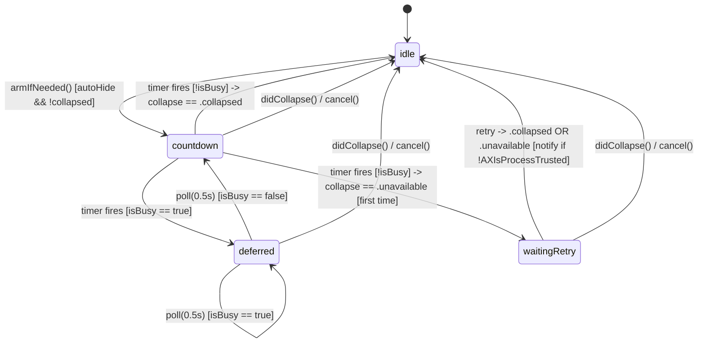

# Architecture & Technical Design

## 1. Overview & Invariants
`AutoCollapseCoordinator` owns all auto-collapse scheduling, idle-deferral, cancellation, and `.unavailable` retry-once state, decoupling timing logic from AppKit in `StatusBarController`.

### Key Invariants
1. **Single Active Timer**: At most one scheduled timer (idle countdown, busy poll, or `.unavailable` retry) exists at any time. Scheduling a new timer cancels any prior timer.
2. **Collapsed/Disabled = Zero Timers**: Whenever the bar is collapsed or `Preferences.isAutoHide == false`, no auto-collapse or retry timer is active.
3. **Idle Countdown**: If any busy predicate (`isMouseInMenuBar`, `isPreferencesWindowVisible`, `isPopupMenuOpen`) is true when the countdown fires, the coordinator enters `.deferred` and polls at `deferralPollInterval` (`0.5s`) until all busy predicates become false, then starts a fresh `numberOfSecondForAutoHide` countdown from the moment interaction became idle.
4. **Single Retry + Accessibility Notification**: On `case .unavailable`, if `hasRetriedUnavailable == false`, schedule 1 retry after `unavailableRetryBackoff` (`2.0s`). On a second `.unavailable`, stop retrying for the current cycle and, if `!isAccessibilityAuthorized()`, notify the user once (per cycle/session) to check Accessibility permission.
5. **Launch Coordination**: `init()` schedules the initial `1.0s` launch collapse without arming a competing auto-collapse timer beforehand; `armIfNeeded()` is only called if launch collapse does not run or resolves `.unavailable`/expanded.

## 2. Domain Models, State & Interface Contracts

```swift
enum AutoCollapseState: Equatable {
    case idle                // no timer armed (collapsed or auto-hide off)
    case countdown           // waiting numberOfSecondForAutoHide before collapse check
    case deferred            // busy; polling every 0.5s until not busy
    case waitingRetry        // .unavailable occurred once; waiting 2.0s for single retry
}

protocol AutoCollapseScheduling {
    func schedule(after delay: TimeInterval, handler: @escaping () -> Void) -> AnyObject
    func cancel(_ token: AnyObject)
}

final class AutoCollapseCoordinator {
    // Inputs / predicates
    var isAutoHideEnabled: () -> Bool
    var delayProvider: () -> TimeInterval
    var isCollapsed: () -> Bool
    var isBusy: () -> Bool
    var isAccessibilityAuthorized: () -> Bool
    var requestCollapse: (_ completion: @escaping (CollapseResult) -> Void) -> Void
    var notifyAccessibilityRequired: () -> Void

    // Events called by StatusBarController
    func armIfNeeded()
    func cancel()
    func didCollapse()
    func didExpand()
    func didBecomeIdleFromMenuOrPrefs()
    func didInvalidateLayoutToExpanded()
    func preferencesChanged()
}
```

### Busy Predicate in `StatusBarController`
`isBusy`:
- `isMouseInMenuBar` (pointer in any screen's menubar strip)
- `isPreferencesWindowVisible` (`PreferencesWindowController.isVisible`)
- `isPopupMenuOpen` (tracked via `NSMenu.didBeginTrackingNotification` / `NSMenu.didEndTrackingNotification` counter + `NotchOverflowController` / context menu tracking)

When `NSMenu.didEndTrackingNotification` fires (or Preferences window closes / `didBecomeIdleFromMenuOrPrefs()`), `AutoCollapseCoordinator` immediately resets the idle countdown if in `.deferred` or `.countdown` so the user gets the full `numberOfSecondForAutoHide` after closing the menu.

## 3. Architecture Diagram & Data Flow



## 4. Boundary Rules & Budgets
- **Pure Core vs. I/O Shell**:
  - **Pure Core**: `AutoCollapseCoordinator` in `hidden/Features/StatusBar/AutoCollapseCoordinator.swift` has zero AppKit window/menu/workspace calls; all clocks, predicates, collapse actions, and notification triggers are injected closures/protocols.
  - **I/O Shell**: `StatusBarController` wires `Timer` scheduler, `NSEvent.mouseLocation`, `NSMenu` tracking notifications, `AXIsProcessTrusted()`, and `UNUserNotificationCenter` (with `NSAlert` fallback when notifications are unauthorized/unavailable).
- **Concurrency, Latency & Resource Budgets** (`NFR-AUTOHIDE-1`):
  - Main-thread only (matching `StatusBarController` and `MenuBarEngine`).
  - `deferralPollInterval`: `0.5s` (`<= 1.0s` budget).
  - `unavailableRetryBackoff`: `2.0s` (`<= 3.0s` budget).
  - Zero background monitors added when `hoverToExpand` is off (`NSMenu` notifications are passive in-process notifications).

## 5. Testing Strategy
1. **BDD Scenarios**: Map each `REQ-AUTOHIDE-1..4` and `NFR-AUTOHIDE-1` scenario directly to tests in `HiddenBarTests/AutoCollapseCoordinatorTests.swift`.
2. **Unit Tests (>= 95% coverage)**:
   - Use a deterministic fake `AutoCollapseScheduling` (manual clock advance) in `HiddenBarTests/AutoCollapseCoordinatorTests.swift`:
     - Idle deferral while `isBusy` is true, then full `N`-second countdown once `isBusy` becomes false.
     - `didCollapse()` (launch and manual) cancels active countdown/deferral/retry timers.
     - `preferencesChanged()` with `isAutoHide = false` cancels active timers.
     - `didInvalidateLayoutToExpanded()` arms countdown when `isAutoHide = true`.
     - `.unavailable` retries once after `2.0s`; recovery on retry cancels cycle without notification; second `.unavailable` with `!isAccessibilityAuthorized()` fires `notifyAccessibilityRequired` once and stops.
     - Second `.unavailable` with `isAccessibilityAuthorized() == true` does NOT fire Accessibility notification.
3. **Mutation Testing (>= 95% kill)**: Verify every branch in `AutoCollapseCoordinator` (state guards, `hasRetriedUnavailable` reset on `didExpand()`/`didCollapse()`, `!isBusy` transitions) has a corresponding failing test if inverted.

## Review Gate
- [x] **Gate 2 Approval**: Architecture & design reviewed and approved by human before task breakdown.
