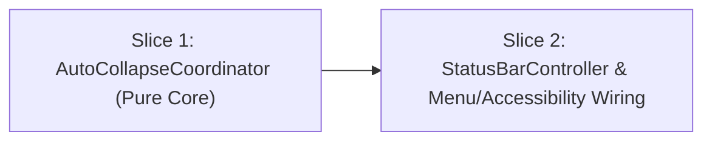

# Tasks

## 1. Dependency DAG

## 2. Streams & Worktrees

| Stream | Worktree Path | Branch | Prerequisite |
| :--- | :--- | :--- | :--- |
| `main-stream` | `.worktrees/consistent-auto-collapse` | `feat/consistent-auto-collapse` | Gate 3 Approval |

## 3. Slice 1: `AutoCollapseCoordinator` (Pure Core)

- [x] 3.0 Contract scaffolding: add `AutoCollapseCoordinator.swift` (`AutoCollapseState`, `AutoCollapseScheduling`, `AutoCollapseCoordinator` stub) to `hidden/Features/StatusBar/` and `HiddenBar.xcodeproj` (verify: `make build` compiles)
- [x] 3.1 Red unit tests in `HiddenBarTests/AutoCollapseCoordinatorTests.swift` covering `REQ-AUTOHIDE-1..4` and `NFR-AUTOHIDE-1` (idle deferral, timer cancellation on collapse/disable, environment re-arming, `.unavailable` single retry + Accessibility notification) (verify: `make test` fails on unimplemented coordinator)
- [x] 3.2 Green implementation of `AutoCollapseCoordinator` (verify: `make test` passes all `AutoCollapseCoordinatorTests` and existing suite)
- [x] 3.3 Coverage >= 95% and mutation >= 95% kill on `AutoCollapseCoordinator.swift` (verify: all branches and state guards exercised by tests)

## 4. Slice 2: `StatusBarController` & Menu/Accessibility Integration

- [x] 4.0 Contract scaffolding: wire `AutoCollapseCoordinator` into `StatusBarController.swift`, add `NSMenu` tracking observers (`didBeginTrackingNotification` / `didEndTrackingNotification`), and Accessibility notification helper (verify: `make build` compiles)
- [x] 4.1 Red/Green integration & behavior verification:
  - `init()` no longer races `autoCollapseIfNeeded()` against the 1s launch `collapseMenuBar()`
  - `collapseMenuBar()` calls `autoCollapseCoordinator.didCollapse()` on `.collapsed` and `handleUnavailable()` on `.unavailable`
  - `invalidateNativeLayoutAfterEnvironmentChange()` calls `didInvalidateLayoutToExpanded()` when `wasCollapsed && !isCollapsed`
  - `updateAutoHide()` calls `preferencesChanged()` (cancelling timer when disabled)
  - `isBusy` includes `isMouseInMenuBar || isPreferencesWindowVisible || isPopupMenuOpen`
  (verify: `make test` and `make build` succeed)
- [x] 4.2 Update `hidden/Features/StatusBar/README.md` to document `AutoCollapseCoordinator` and popup-menu deferral contract (verify: doc matches code)

## 5. Integration & Rebase Plan
- [ ] 5.1 Human Comprehension Verification: reviewer can explain `AutoCollapseCoordinator` state transitions and `StatusBarController` wiring line-by-line
- [ ] 5.2 Rebase on `develop`, re-verify `make test` and `make build`, `openspec archive consistent-auto-collapse`

## Review Gate
- [x] **Gate 3 Approval**: Tasks breakdown approved by human before writing test code.
